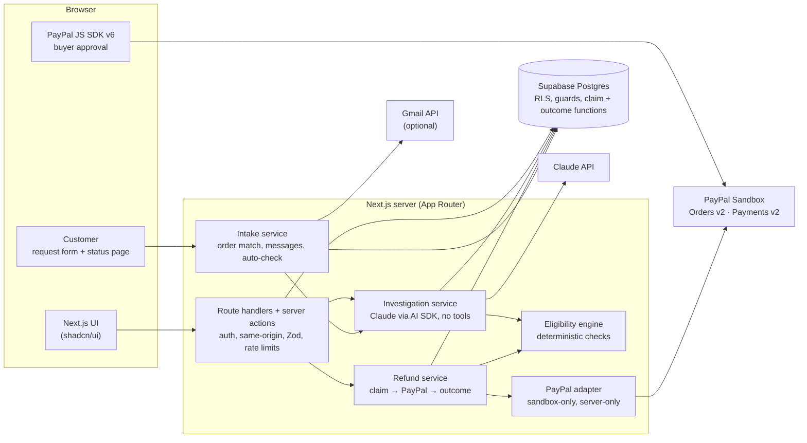

# Settlix

**Resolve payments intelligently.** Settlix is an AI-assisted refund resolution workspace for
merchants. Claude investigates a customer's refund request against the order, payment, and the
merchant's own return policy; deterministic server-side rules validate every proposed action; a
merchant explicitly approves; and the refund is executed through the **PayPal Sandbox** with a
traceable Resolution Receipt.

Built for the PayPal AI Hackathon 2026. Everything runs against the PayPal **Sandbox**: no real
money moves.

- Live demo: **https://settlix-demo.vercel.app** (sign in with the public demo account shown on
  the sign-in page: `demo@settlix.example` / `settlix-sandbox-demo`)
- Demo video: _added after recording_
- Product spec: [`docs/PRD.md`](docs/PRD.md) · Build log: [`docs/ROADMAP.md`](docs/ROADMAP.md)

---

## 1. Product summary

A refund request is a small investigation: does the order exist, was it paid, what does the policy
say, is the customer's story consistent with the records, has it been refunded already? Settlix
does that investigation with Claude, shows its evidence and cited policy clauses, re-checks
everything with deterministic rules that the AI can't override, and only then lets an authorized
merchant approve a specific amount. The PayPal result (refund ID and status) is shown exactly as
PayPal returns it.

## 2. Problem and target user

Small and mid-size online merchants resolve refund requests by hand across a help desk, their order
system, a policy document, and PayPal. That is slow and error-prone: refunds outside the policy,
double refunds, refunds of the wrong amount, and no record of why a decision was made. Settlix is
for the support lead or owner who approves refunds and needs each decision to be fast, consistent
with policy, and auditable.

## 3. Features

- **A refund request form for customers**: one link per store (`/r/<store>`), no account and no
  captcha. The customer types their order number (or the Transaction ID from PayPal's receipt) and
  the email they paid with; a request opens only when both match a paid order. Share it as a QR
  code, a printable card, or ready-made text for an email signature, order confirmation, website
  button, or chat. Each link is tagged so the merchant sees which one customers use.
- **A private status page for every request** (`/status/<token>`): where the request stands
  (received, being reviewed, decision, refunded), the messages between customer and store, and a
  box to reply. It never shows Claude's suggestion, and it only says "refunded" once PayPal confirmed
  it.
- **Claude checks new requests on arrival** (optional, about $0.002 per check, capped at 20 an
  hour per store), and again when the customer sends information the store asked for. Claude still
  only suggests.
- **Messages to the customer** from the request page: Claude's draft (or a factual refund message
  once PayPal confirmed), sent from the store's Gmail in the same thread, or posted to the
  customer's page and opened in the merchant's own email app.
- **Gmail, optional**: one Google screen connects it. Settlix can send replies from the merchant's
  address and bring in refund emails: a reply in a request's thread joins that request, an email
  from the order's buyer (sender verified by Gmail) opens one, and anything else waits in "Emails to
  sort". It checks when the inbox opens, on "Check Gmail now", and once a day.
- **Refund requests** (the inbox): search, quick views, filter by stage and reason, sort by date or
  amount, the latest suggestion from Claude per request; the Overview's stages link straight to a
  filtered view.
- **Cases from real sandbox payments**: run a PayPal Sandbox checkout in the app (JS SDK v6), then
  open a refund case for the captured payment.
- **AI investigation** (Claude via the Vercel AI SDK): structured, schema-validated recommendation
  with extracted facts, cited policy clauses (verified word for word against the stored policy),
  evidence for and missing, contradictions, risk flags (including prompt-injection attempts), and a
  draft customer reply. Customer text is treated as untrusted data.
- **Deterministic eligibility engine**: 17 checks (capture mapping, payment state, currency,
  refundable balance including unresolved refunds, return window, review threshold, citations,
  evidence, contradictions, risk flags, freshness, …). It can only be stricter than the AI.
- **Explicit approval → real PayPal refund**: the server recomputes the amount, claims the refund
  atomically in Postgres (row locks + one unresolved attempt per order + idempotency key), records
  the approval, then calls PayPal with `PayPal-Request-Id`. Only a verified `COMPLETED` refund marks
  a case refunded.
- **Recovery for uncertain outcomes**: a timeout or unreadable answer marks the attempt
  `RECOVERY_REQUIRED`; "Check with PayPal" reads the refund or replays the identical request with
  the same `PayPal-Request-Id`, so PayPal returns the original refund instead of creating another.
- **Resolution Receipt**: recommended vs. actual outcome, approver, PayPal refund ID and HTTP
  status, decision basis, verified policy evidence, audit timeline, factual customer reply, and a
  copyable summary.
- **Return policies**: versioned, published versions are immutable, one active version per
  policy, clause-level citations.
- **Overview**: a one-sentence summary of what needs you, requests by stage on one line, who is
  waiting, money refunded per day (PayPal-confirmed refunds only; demo records and pending amounts
  excluded), recent refunds, and live connection checks for PayPal and Claude.
- **Case actions**: add merchant notes, request evidence, send to review, decline.
- Written for non-technical merchants: plain language, a four-step progress tracker on every
  request, larger type, and technical IDs behind "PayPal references" disclosures. A ⌘K menu jumps
  to any page.
- Light and dark themes in a PayPal-inspired palette; works on phone, tablet, and desktop. The
  landing page shows the product working (an interactive request check, the request lifecycle, and
  the receipt), animated with GSAP and calm under reduced motion.

## 4. Architecture



- The browser only ever sends IDs (a catalog item, a PayPal order ID, a case ID) and a
  confirmation of what the merchant saw. Prices, amounts, mappings, and eligibility are computed on
  the server.
- Reads use the signed-in user's Supabase session (row-level security limits every row to the
  member's merchant). Writes happen only in server-only code with the service key, after an
  authorization check, always scoped to the member's merchant.
- Postgres enforces the money invariants: case and refund status transition guards, immutable
  refund intent, append-only audit events and investigations, one unresolved refund attempt per
  order, and `claim_refund_attempt()` / `record_refund_outcome()` for atomic state changes.
- The AI is advisory: it gets read-only, merchant-scoped context and no tools. It can't approve,
  refund, or override a failed check.
- Customer pages have no session: the store comes from the link, a request needs a paid order
  plus the buyer's email, the status page needs its 64-character token, and every write is rate
  limited per visitor and per store.

Code map: `src/app` (routes), `src/lib/ai` (prompt, schema, Claude call, evals),
`src/lib/policy` (eligibility engine, citation validation), `src/lib/investigations`,
`src/lib/refunds`, `src/lib/paypal` (adapter), `src/lib/payments` (checkout), `src/lib/receipts`,
`src/lib/intake` (request form, status page, messages), `src/lib/gmail` (OAuth, sync, send),
`supabase/migrations`, `tests/`. See [`CLAUDE.md`](CLAUDE.md) for a fuller guide.

## 5. Technologies used

Next.js 16 (App Router, Cache Components, React Compiler) · TypeScript · Bun · shadcn/ui
(Tailwind CSS v4, Base UI, Lucide) · Supabase (Postgres, Auth, RLS) · Vercel AI SDK with
`@ai-sdk/anthropic` and Zod · Claude · PayPal REST APIs (Orders v2, Payments v2) and the PayPal
JS SDK v6 · Bun test · Playwright with axe-core.

## 6. Prerequisites

- [Bun](https://bun.sh) 1.4 or newer (the project uses Bun for installs, scripts, and tests).
- A [Supabase](https://supabase.com) project (the free tier is enough).
- A [PayPal Developer](https://developer.paypal.com) account with sandbox accounts and a REST app.
- An [Anthropic API key](https://console.anthropic.com) and a Claude model ID.

## 7. Local setup

```bash
git clone https://github.com/orbitratechnology/settlix.git
cd settlix
bun install
cp .env.example .env.local   # then fill in the values (see below)
```

| Variable                                                           | Where it's used                                        |
| ------------------------------------------------------------------ | ------------------------------------------------------ |
| `NEXT_PUBLIC_SUPABASE_URL`, `NEXT_PUBLIC_SUPABASE_PUBLISHABLE_KEY` | Browser and server (safe to expose)                    |
| `SUPABASE_SECRET_KEY`                                              | Server only: privileged writes and the seed script     |
| `ANTHROPIC_API_KEY`, `ANTHROPIC_MODEL`                             | Server only: investigations (e.g. `claude-haiku-5-5`)  |
| `PAYPAL_CLIENT_ID`, `PAYPAL_CLIENT_SECRET`                         | Server only (the client ID is also used by the JS SDK) |
| `PAYPAL_BASE_URL`                                                  | Optional; only the sandbox URL is accepted             |
| `PAYPAL_SANDBOX_BUYER_EMAIL`, `PAYPAL_SANDBOX_BUYER_PASSWORD`      | Live end-to-end tests only                             |
| `GOOGLE_CLIENT_ID`, `GOOGLE_CLIENT_SECRET`                         | Optional, server only: "Connect Gmail" (section 11)    |
| `SETTLIX_ENCRYPTION_KEY`                                           | Optional, server only: encrypts Gmail tokens at rest   |
| `CRON_SECRET`                                                      | Optional: the daily Gmail check (Vercel Cron)          |
| `SETTLIX_SITE_URL`                                                 | Optional: pins the origin used in links and redirects  |
| `SETTLIX_TEST_FAULTS`, `E2E_LIVE`                                  | Tests only; never set in a deployed environment        |

Then apply the database (next section), seed it, and start the app:

```bash
bun run db:seed   # demo merchant, demo account, policy versions, labeled demo cases
bun run dev       # http://localhost:3000
```

## 8. Supabase configuration and migrations

The schema lives in [`supabase/migrations`](supabase/migrations); apply the files in filename
order. Either:

- with the [Supabase CLI](https://supabase.com/docs/guides/cli): `supabase link --project-ref
<your-ref>` then `supabase db push`, or
- paste each file into the Supabase SQL editor, oldest first.

Then run `bun run db:seed`. The seed is idempotent and insert-only: it creates the public demo
account (`demo@settlix.example`, password shown on the sign-in page), the "Harbor & Pine Supply
Co." demo merchant, three versions of its return policy (v3 active), ten labeled demo cases that
cover the PRD scenarios, and a second merchant with no members used to test isolation. Demo rows
never carry PayPal IDs and never claim a real refund happened.

Auth: Settlix uses email and password sign-in. In Supabase → Authentication → URL Configuration,
set the Site URL to your deployed URL (and add `http://localhost:3000` for local work).

## 9. Claude API configuration

Set `ANTHROPIC_API_KEY` and `ANTHROPIC_MODEL` on the server. The model ID is configuration, never
hardcoded. The investigation prompt and output schema are versioned (`src/lib/ai/prompts.ts`,
`src/lib/ai/schemas.ts`). To measure behavior on the PRD's evaluation scenarios:

```bash
bun run ai:eval --runs 3   # writes evals/results/*.json; never touches the database
```

## 10. PayPal Sandbox configuration

1. In the [PayPal Developer Dashboard](https://developer.paypal.com/dashboard/), open **Sandbox
   accounts**. You need a **Business** account (the merchant) and a **Personal** account (the
   buyer); PayPal creates one of each by default.
2. Under **Apps & Credentials** (Sandbox), create a REST app for the Business account and copy its
   client ID and secret into `PAYPAL_CLIENT_ID` and `PAYPAL_CLIENT_SECRET`.
3. Optional, for the live end-to-end tests: put the Personal account's email and password in
   `PAYPAL_SANDBOX_BUYER_EMAIL` / `PAYPAL_SANDBOX_BUYER_PASSWORD`, and turn on **Negative testing**
   for the Business account (Sandbox accounts → ⋮ → View/Edit account → Settings) so the suite can
   ask PayPal for a real decline.

Check the connection on the **Payments** page (it shows the REST app ID, never the secret).
`bun run paypal:smoke create` / `finish <ORDER_ID>` proves the adapter end to end without the UI.

## 11. Request form, status page, and Gmail

**The request form works without any setup.** Open **Request form** in the sidebar: copy the link,
download the QR code, print a card, or copy ready-made text. On the demo store, the form
(`/r/harbor-pine-demo`) offers two demo orders to try (HP-10452 with `sam.rivera@example.com`,
HP-10458 with `ana.souza@example.com`); the request appears in the demo store's dashboard and the
customer lands on their status page.

Settlix matches a request to an order by the store's order number or PayPal's Transaction ID, plus
the buyer's email. Sandbox payments keep the PayPal buyer's email from the capture
(`scripts/backfill-order-buyers.ts` fills it in for payments made before Phase 9).

**Gmail (optional)** needs a Google OAuth client:

1. In the [Google Cloud console](https://console.cloud.google.com/), create a project and enable
   the **Gmail API**.
2. Under **Google Auth Platform**, set up the consent screen: user type **External**, app name
   "Settlix", your support email. Add the scopes `openid`, `email`, `gmail.send`, and
   `gmail.readonly`. While the app is in **Testing**, add each merchant's Google account as a test
   user.
3. Create an **OAuth client ID** of type **Web application** with these authorized redirect URIs:
   `http://localhost:3000/api/integrations/gmail/callback` and
   `https://<your-domain>/api/integrations/gmail/callback`.
4. Set `GOOGLE_CLIENT_ID`, `GOOGLE_CLIENT_SECRET`, and `SETTLIX_ENCRYPTION_KEY`
   (`openssl rand -base64 32`). For the daily check on Vercel, also set `CRON_SECRET`
   (`vercel.json` schedules `/api/cron/gmail-sync` once a day, which the Hobby plan allows).
5. In Settlix, **Request form → Gmail → Connect Gmail**. Untick either permission if you only want
   one. Gmail can't be connected to the shared demo store.

What Google requires: in **Testing**, Google limits the app to 100 test users and ends access after
7 days; Settlix then shows "Reconnect Gmail", one click with the account filled in. To publish the
app, Google verifies it: `gmail.send` is a _sensitive_ scope (verification, no fee);
`gmail.readonly` is a _restricted_ scope that also needs a yearly third-party security assessment.
A store that only wants to send replies can connect with "Send replies" alone.

## 12. Create and capture a test payment

1. Sign in (the demo account works) and open **Payments**.
2. Choose a test item and click **Pay with PayPal**.
3. In the PayPal window, sign in with the sandbox **Personal** account and pay with the sandbox
   card.
4. Settlix captures the order on the server and lists the payment as **Paid** under **Test
   payments**, with its PayPal order and payment (capture) IDs under **PayPal references**.

## 13. Investigate and approve a refund

1. On the paid payment, click **Create request** and enter the customer's request. A payment that
   is only minutes old fits one honest scenario: the customer asks to **cancel before dispatch**
   (policy rule CN-1). For example: reason "Changed mind", message "I ordered this by mistake,
   please cancel it before it ships", and a note confirming the order hadn't been packed or
   shipped.
2. On the request page, click **Check this request**. Claude's suggestion appears with the quoted
   rules (each marked "Quote checked" against the stored policy), and **Your decision** shows
   Settlix's own checks.
3. If the request is **Ready to approve**, click **Approve and issue refund**, review the amount
   and what is left afterwards, and confirm.
4. The dialog shows PayPal's actual result, for example "PayPal sent $42.00 back to the customer
   (PayPal reference 1J3010819W148030C)", and links to the receipt.

To see Settlix decline to act, open a seeded case such as **DEMO-103** (no photo for a damage
claim: Claude asks for evidence, no refund action) or **DEMO-109** (prompt injection in the
customer message: flagged and sent to review).

## 14. Verify the receipt

Click **Open receipt** (or **Receipt** on the case). The Resolution Receipt shows the recommended
vs. actual outcome, the approver and time, the refund attempt and **PayPal refund ID**, the HTTP
status PayPal returned, the decision basis, verified policy evidence, the mapped order and capture,
a factual customer reply, and the audit timeline. You can confirm the refund in the sandbox Business
account's activity, or with `GET /v2/payments/refunds/{id}`.

## 15. Tests

```bash
bun run check      # lint, format check, typecheck, unit + integration tests (Bun)
bun run build      # production build
bun run test:e2e   # Playwright suite (see below)
```

- **Unit** (`*.test.ts` next to the code): money conversion, eligibility rules, citation
  validation, context hashing, prompt escaping, AI failure mapping, PayPal adapter (mocked
  `fetch`), refund outcome mapping, receipts, inbox filtering, test-fault guards, order-number
  matching, the request classifier, customer-facing statuses and drafts, token encryption, Google
  OAuth (PKCE, granted scopes, ID token checks), outgoing email building (header injection), and
  incoming email parsing (quotes, attachments, sender authentication).
- **Integration** (`tests/integration/`, against your Supabase project; skipped without env):
  row-level security and merchant isolation, policy immutability, the investigation service with a
  mock model (incl. timeouts and invalid output), and the refund workflow with a PayPal test double
  (concurrent approvals, tampered amounts, rejection, pending, unknown outcome → reconciliation with
  the same request, partial refunds, other merchants, rate limits), the public request form (order
  and email matching, amounts, follow-ups, per-visitor limits), the status page and store messages,
  and the Gmail sync and send with a Google double. Each run creates its own test merchant.
- **End to end** (`tests/e2e/*.e2e.ts`, Playwright): PRD §17.3 E2E-01 to E2E-08 plus a PayPal
  decline; E2E-09 (a signed-out customer asks through the form, the store asks for more, the
  customer replies on their status page) and E2E-10 (form link, QR code, printable card, pausing
  the form); and an axe-core WCAG 2.1 AA audit of every screen, customer pages included, in light
  and dark mode. The suite uses
  its own "Settlix E2E Store" workspace. Specs that need the real PayPal Sandbox and Claude run only
  with `E2E_LIVE=1`; they drive the real PayPal buyer window and read PayPal's own records back. The
  model-failure and lost-response scenarios use a test-only fault switch that only works outside
  production with `SETTLIX_TEST_FAULTS=1`.

Tests that use PayPal test doubles prove software behavior, not real refunds; the live end-to-end
specs and the receipts above are the real sandbox evidence.

## 16. Deployment (Vercel)

1. Import the repository in [Vercel](https://vercel.com/new); the Next.js preset and `bun.lock` are
   detected automatically.
2. Add the environment variables from section 7 (not the test-only ones) to the Production
   environment. For Gmail, add the production callback URL to the Google OAuth client (section 11)
   and set `CRON_SECRET` for the daily check.
3. Deploy, then set the Supabase Site URL to the deployment URL (section 8).
4. Check from a fresh browser: the landing page, sign-in with the demo account, the dashboard's
   integration health (Supabase, PayPal, Claude), and one checkout → case → investigate → approve
   → receipt run.

## 17. Security notes

- Secrets (`SUPABASE_SECRET_KEY`, `PAYPAL_CLIENT_SECRET`, `ANTHROPIC_API_KEY`) are read only by
  server-only modules; only `NEXT_PUBLIC_*` values reach the browser.
- Every merchant-owned table has row-level security; client roles can only read their merchant's
  rows. All writes go through server code that checks the member's role and scopes by their
  merchant. Another merchant's records look exactly like records that don't exist.
- JSON routes require a same-origin request and a signed-in member; inputs are validated with Zod;
  payment endpoints are rate limited per merchant in Postgres.
- The browser's amount is only a confirmation: the server recomputes eligibility and the amount,
  and Postgres re-checks the balance while it claims the refund.
- Customer messages and policy text are untrusted data inside the prompt, never instructions; the
  model has no tools.
- The PayPal adapter refuses any non-sandbox base URL. Logs carry PayPal debug IDs and sanitized
  summaries, never tokens or authorization headers.
- The public demo account belongs to the demo workspace only and can only make sandbox payments.
- Public form: the store comes from the link, never from the form; a request needs a paid order
  of that store and the buyer's email (one vague answer for every mismatch); a hidden honeypot
  field; 10 attempts per visitor (hashed IP) and 60 per store per hour, in Postgres.
- Status pages are found only by a random 64-character token; they're never indexed, never sent
  as a referrer, and show no AI output, checks, notes, or IDs.
- Automatic emails (the confirmation) go only to a buyer the form or Gmail verified, so the public
  form can't make a store email strangers. Everything else is sent only when a merchant clicks
  Send.
- Gmail: OAuth with PKCE and a sealed, short-lived state cookie; only the permissions the merchant
  ticks (Google's granular consent respected); refresh and access tokens encrypted with AES-256-GCM,
  bound to the merchant, in a table no client role can read; disconnect revokes the token at Google.
  Settlix asks Gmail only for refund-looking mail, never changes or deletes email, and never
  downloads attachments. Email content is untrusted data, like any customer message.

## 18. Known limitations

- **Sandbox only.** Settlix refuses non-sandbox PayPal URLs; no real payments are processed.
- **No PayPal webhooks yet.** A refund PayPal reports as pending stays pending until someone clicks
  "Check with PayPal" (sandbox refunds normally complete immediately).
- **Payments come from the in-app sandbox checkout.** There is no import of existing PayPal
  transactions, and each order is a single catalog item in USD.
- **Fresh payments limit realistic scenarios.** A payment made minutes ago has no shipping record,
  so claims about how an item _arrived_ are, correctly, sent to review; cancellation before
  dispatch (CN-1) and price adjustments are the scenarios that fit a live demo.
- **AI output varies between runs.** The deterministic checks bound what an investigation can
  approve, and the eval script measures consistency (30/30 schema-valid, 29/30 correct action and
  outcome on the PRD scenarios), but a re-run can reach a more cautious outcome.
- **Manual review has no separate approval path.** A reviewer resolves a "Needs review" case by
  adding notes and re-running the investigation, or by declining it.
- **Orders must be known to Settlix.** The request form matches PayPal payments Settlix recorded
  (the in-app sandbox checkout and demo orders); there is no import from other shops or platforms
  yet.
- **Gmail in Google's Testing mode** ends access after 7 days (one-click reconnect) and allows 100
  test users; publishing needs Google's verification (section 11).
- **Attachments stay in Gmail.** Settlix notes that a customer attached a photo, but Claude can't
  see it; the merchant adds a note after looking.
- **Gmail is checked, not pushed.** New emails arrive when someone opens the inbox, clicks "Check
  Gmail now", or once a day.
- **The demo account is shared**, so anyone using it sees the same demo workspace and its sandbox
  activity.

## 19. Demo video

_Link added after recording._ The script follows PRD §19: the problem (0:00), the inbox (0:15), the
AI investigation with cited clauses and checks (0:35), approval (1:05), the real sandbox refund and
its ID (1:25), the Resolution Receipt (1:55), a blocked or review case (2:20), and the close
(2:35).

## License

[MIT](LICENSE) © 2026 Orbitra Tech
